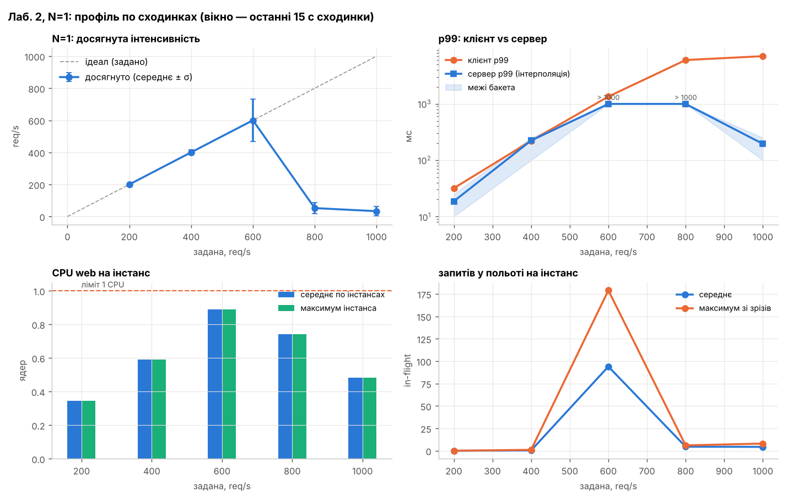
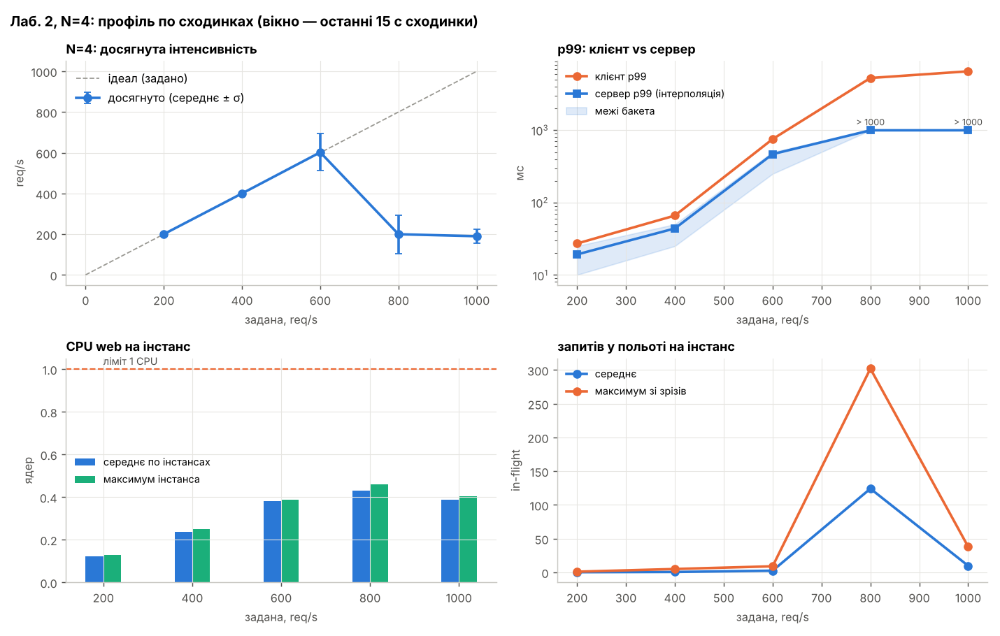
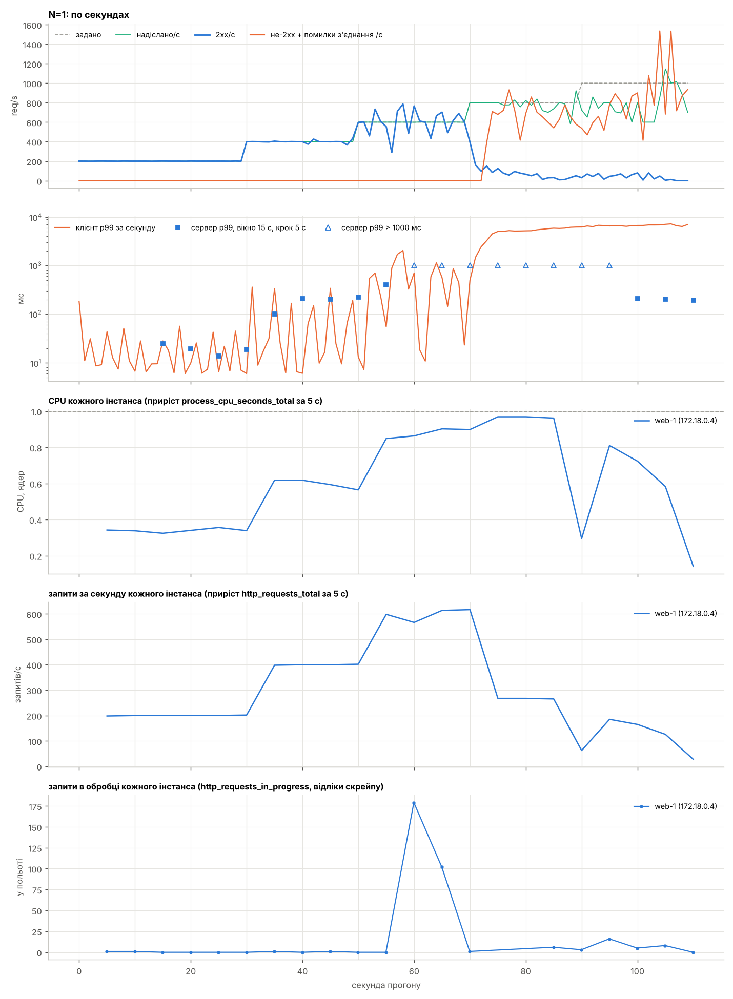
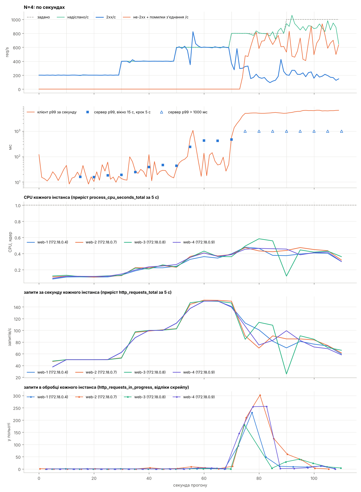
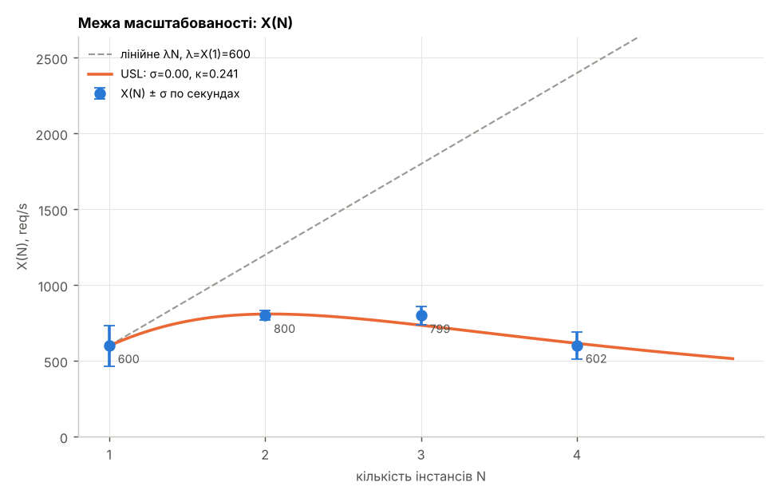
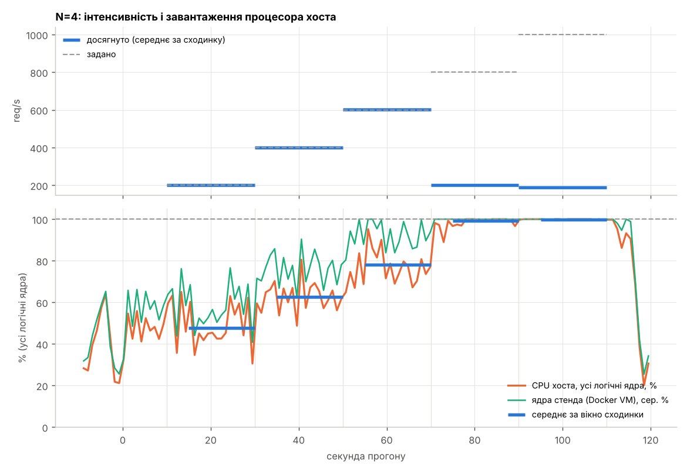
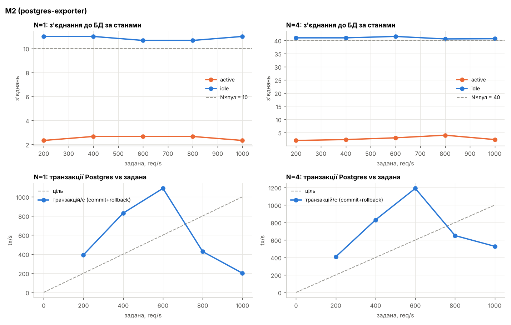
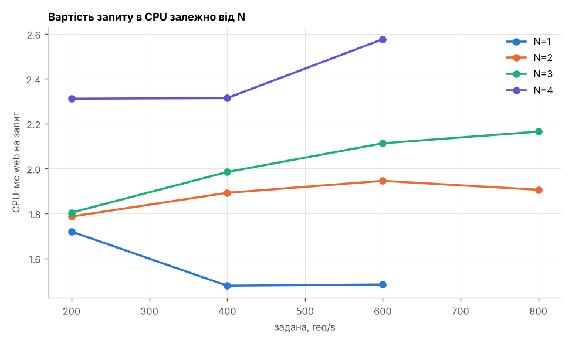

# Практична робота 2. Метрики сервісу і межа масштабованості

Варіант 3

Виконав студент гр. ЗК-61мп Бігвава Темур

| Параметр | Значення |
|---|---|
| Розмір пулу з'єднань | `DB_POOL_SIZE = 10` |
| Бакети гістограми (Г1) | 5, 10, 25, 50, 100, 250, 500, 1000 мс |
| Додаткова метрика (М2) | postgres-exporter: з'єднання з БД за станами (active, idle) проти N×пул; транзакції/с проти заданої інтенсивності |
| Ліміт контейнера web | 1 CPU / 512 МБ |
| Docker VM | 6 логічних ядер хоста; VM прив'язано до ядер 0–3 (4 ядра), `vmmemWSL`, ≈ 12,4 ГБ RAM |
| Генератор | 2 процеси, прив'язані до ядер 4–5 (окремо від стенда) |
| Тестове навантаження | `GET /appointments/{id}` (з Лаб. 1), відкрита модель, сходинки +200 req/s |

## 1. Метрики сервісу (кроки 1–2)

У застосунок (FastAPI + uvicorn) додано `prometheus_client` через ASGI-проміжний обробник (`app/metrics.py`):

- `http_requests_total{method, path, code}`: лічильник запитів; `path` — шаблон маршруту (`/appointments/{appointment_id}`), а не конкретний id, щоб не множити ряди;
- `http_request_duration_seconds{method, path}`: гістограма з бакетами Г1;
- `http_requests_in_progress`: gauge запитів у польоті;
- заголовок `X-Pod` у кожній відповіді (ім'я контейнера), що дозволило перевірити розподіл запитів балансувальником між інстансами.

Заголовок `X-Pod` є і у відповідей 500 на необроблений виняток: `ServerErrorMiddleware` стоїть зовні `MetricsMiddleware`, тому такий виняток перехоплюється всередині `MetricsMiddleware` (`app/metrics.py`), який сам формує відповідь 500 із `X-Pod`, пише виняток у лог і враховує запит у метриках з кодом 500.

Окремо додано `/livez` (процес живий, без звернення до БД) та `/metrics`, який у статистику не входить. Розмір пулу задається змінною `DB_POOL_SIZE` (10).

## 2. Graceful shutdown (крок 3)

`app/run.py` запускає uvicorn із `timeout_graceful_shutdown=25` с, а `stop_grace_period` у Compose дорівнює 30 с. Перед запуском ставиться заглушка для SIGTERM (`SIG_IGN`): після коректної зупинки uvicorn повертає попередній обробник і повторно шле собі сигнал; без заглушки процес гинув би від SIGTERM з кодом 143.

### Перевірка під навантаженням

Два інстанси web за nginx, навантаження 400 req/s (прогрів 10 с + одна сходинка 60 с, генератор на ядрах 4–5). На ≈ 17-й секунді сходинки виконано `docker stop` одного з інстансів (`scripts/run-stop-check.ps1`; обробка: `analysis/stop_check.py`; сирі дані: `results/stop_check.json`, `results/stop_check_seconds.csv`, `results/stop_check_meta.json`).

Код завершення (`results/stop_check_exitcode.txt`):

```
docker inspect --format '{{.State.ExitCode}}' hpc_lab2-web-2  ->  0
```

`docker stop` виконувався 0,73 с (секунди 27–28 прогону). Посекундний запис генератора за 10 с навколо зупинки (секунди 22–31; ◄ — секунда початку `docker stop`):

| секунда | задано | надіслано | 2xx | не-2xx | помилки зʼєднання | p99 клієнта, мс |
|---|---|---|---|---|---|---|
| 22 | 400 | 400 | 400 | 0 | 0 | 6,6 |
| 23 | 400 | 400 | 398 | 0 | 0 | 12,3 |
| 24 | 400 | 400 | 402 | 0 | 0 | 32,0 |
| 25 | 400 | 400 | 400 | 0 | 0 | 6,7 |
| 26 | 400 | 400 | 400 | 0 | 0 | 6,9 |
| 27 ◄ docker stop | 400 | 400 | 399 | 0 | 0 | 53,1 |
| 28 | 400 | 400 | 392 | 0 | 0 | 74,1 |
| 29 | 400 | 400 | 408 | 0 | 0 | 1005,7 |
| 30 | 400 | 400 | 338 | 0 | 0 | 221,0 |
| 31 | 400 | 400 | 462 | 0 | 0 | 349,9 |

Разом за 10 с: 2xx = 3999, не-2xx = 0, помилок зʼєднання = 0.
За весь прогін (70 с): не-2xx = 0, помилок зʼєднання = 0.

Помилок немає, але зупинка помітна у затримках: p99 клієнта зростає з ≈ 7 мс до 1005,7 мс у секунді 29, а кількість 2xx на секунду коливається (338 у секунді 30 і 462 у секунді 31), бо запити, що потрапили на зупинений інстанс, nginx повторює на живому. За ці 10 с надіслано 4000 запитів, 3999 отримали 2xx в тій самій секунді, а одна відповідь «переїхала» в сусідню секунду (запис ведеться за секундою завершення).

#### Що довелося виправити в nginx

У першій спробі після зупинки інстанса клієнт отримував помилки: 

1. Поки uvicorn закриває listener, nginx бачить `Connection refused` на цей upstream.
2. Після завершення процесу адреса мертвого контейнера недосяжна: ARP-проба триває ≈ 3 с, а nginx має по одному стану відмов на кожен із 6 воркерів.

Виправлення в `nginx.conf` (блок `location /`):

```nginx
proxy_connect_timeout 1s;
proxy_next_upstream error timeout;
proxy_next_upstream_tries 3;
```

Після цього запити, що потрапляють на мертвий інстанс, автоматично повторюються на живому. У логу nginx помилки лишаються: кожні ≈ 12 с (10 с `fail_timeout` + 1 с очікування) nginx знову пробує мертву адресу, але клієнт цього не бачить: усі такі запити повторено на живому інстансі й закінчуються кодом 2xx.

## 3. Prometheus у Compose (крок 4)

Prometheus (v3.5.0) збирає метрики кожні 5 с (`scrape_timeout` 4 с). Інстанси web знаходяться через `dns_sd_configs` (тип `A`, ім'я `web`, порт 8000, `refresh_interval` 5 с), тому після `docker compose up -d --scale web=N` усі N контейнерів стають цілями (`up = 1`). Додатково працює `postgres-exporter` (статична ціль). Після масштабування перезапускається `lb`, бо nginx розв'язує адресу `web` лише при старті.

## 4. Генератор навантаження (кроки 5–6)

Відкритий (open-loop) генератор: 2 процеси, **прив'язані до ядер 4–5** (`--cpus 4,5`); стенд (Docker VM) прив'язано до ядер 0–3, тож генератор не ділить процесор зі стендом. Прогрів 10 с при 200 req/s, далі сходинки по 20 с із кроком 200 req/s, запис по секундах, тайм-аут запиту 5 с (вважається не-2xx). Зупинка — після двох сходинок поспіль з досягнутою інтенсивністю нижче 0,9 від заданої. Показник X(N) — середня досягнута інтенсивність за останні 15 с найкращої сходинки з точністю до сходинки 200 req/s, тож істинна межа лежить у [X; X+200).

Для кожної сходинки генератор записує, скільки запитів реально надіслано за секунду (`sent_rps`) і CPU своїх процесів за ті самі 15 с (`generator_cpu_cores`, приріст процесорного часу з посекундних відліків).

**Межа генератора G.** Проганяємо той самий профіль на `/noop` (nginx відповідає 204 без звернення до web): G ≈ **4785 req/s** (сходинка 4800, σ = 58; `results/step_noop.json`). Усі точки X(N) ≤ 800 req/s, тобто нижче 0,9·G ≈ 4307, тож генератор і балансувальник не обмежують результат.

**Чи надсилає генератор стільки, скільки задано.** На всіх сходинках до сходинки X(N) включно `sent_rps` дорівнює заданому з точністю 0,5 % (див. колонку «надіслано» в таблицях розділу 5). Відставання від розкладу є лише на сходинках після колапсу сервісу, коли генератор витрачає ≈ 1,5 з двох своїх ядер на тисячі помилок з'єднання (`EOFError`, `ConnectionResetError`) і тайм-аутів:

| N | сходинка | задано | надіслано |
|---|---|---|---|
| 1 | 4 | 800 | 774,3 |
| 1 | 5 | 1000 | 786,7 |
| 2 | 5 | 1000 | 888,0 |
| 2 | 6 | 1200 | 1066,7 |
| 3 | 5 | 1000 | 851,1 |
| 3 | 6 | 1200 | 1071,9 |
| 4 | 5 | 1000 | 873,6 |

Запізнення планувальника p99 за весь прогін: 4616 / 4852 / 5053 / 2892 мс для N = 1 / 2 / 3 / 4, воно набирається саме на цих сходинках. Оскільки після колапсу вимірювані величини (досягнуте, p99) описують стан перевантаженого стенда, а не межу, а X(N) береться до колапсу, це не впливає на X(N). Повністю прибрати відставання в режимі колапсу можна лише відданням генератору більшого числа ядер за рахунок стенда.

## 5. Результати X(N) (крок 7)

| N | X(N), req/s | σ по секундах | остання сходинка ≥ 0,9·задана? | X ≥ 0,9·G? | надіслано = задано на всіх сходинках? | запізнення планувальника p99, мс |
|---|---|---|---|---|---|---|
| 1 | 600,0 | 133,5 | ні | ні | ні | 4616 |
| 2 | 800,0 | 31,9 | ні | ні | ні | 4852 |
| 3 | 799,1 | 58,9 | ні | ні | ні | 5053 |
| 4 | 602,1 | 90,9 | ні | ні | ні | 2892 |

G = 4785,5 req/s.

Колонка «надіслано = задано на всіх сходинках» враховує всі сходинки прогону, у тому числі після колапсу, де генератор відстає (розділ 4); до сходинки X(N) включно надіслано рівно задане у всіх чотирьох прогонах.

N=1 обмежений лімітом 1 CPU у web (0,89 ядра на сходинці 600 req/s), точки при N>1 не обмежені ні генератором, ні балансувальником (X ≪ 0,9·G), тому зменшення CPU-ліміту web удвічі до 0,5 не потрібне.

**Повторюваність N=4.** Прогін N=4 довелося повторити п'ять разів (поки не вдалося зняти на одному прогоні сирі результати, Prometheus, `docker stats` і CPU хоста). X(4) вийшло: 796,9 → 599,8 → 623,2 → 809,9 → 602,1 req/s. Тобто 800 req/s — край можливостей чотирьох ядер: прогін то тримає цю сходинку, то обвалюється на ній. У репозиторії лежить лише останній прогін (602,1); числа попередніх взято з виводу генератора. Усі таблиці, діаграми, `docker stats` і CPU хоста у звіті — з цього останнього прогону.

### Детальні таблиці прогонів

Кожна сходинка: вікно — останні 15 с. Колонки: задано, надіслано (середнє за вікно), досягнута інтенсивність ± σ по секундах, частка не-2xx, p99 клієнта, p99 сервера (інтерполяція в бакеті, у дужках межі бакета і похибка — ширина бакета), CPU одного інстанса web (середнє / максимум), запити у польоті на інстанс (середнє / максимум), з'єднання з БД (active / idle), транзакції Postgres за секунду, CPU web на запит, CPU процесів генератора за ці 15 с.

#### N=1

| сх. | задано | надіслано | досягнуто ± σ | не-2xx % | p99 клієнт | p99 сервер (межі, похибка) | CPU/інст. (сер/макс) | in-flight | pg act/idle | tx/с | CPU-мс/запит | CPU генер., ядер |
|---|---|---|---|---|---|---|---|---|---|---|---|---|
| 1 | 200 | 200,0 | 200,0 ± 0,7 | 0,0 | 31,8 | 18,7 [10; 25], ±15 | 0,34/0,34 | 0,0/0 | 2,3/11,0 | 393 | 1,72 | 0,11 |
| 2 | 400 | 400,0 | 400,3 ± 16,2 | 0,0 | 221,0 | 223,1 [100; 250], ±150 | 0,59/0,59 | 0,3/1 | 2,7/11,0 | 830 | 1,48 | 0,21 |
| 3 | 600 | 599,9 | 600,0 ± 133,5 | 0,0 | 1351,7 | > 1000 мс | 0,89/0,89 | 94,0/179 | 2,7/10,7 | 1089 | 1,48 | 0,37 |
| 4 | 800 | 774,3 | 52,5 ± 32,9 | 86,6 | 6017,2 | > 1000 мс | 0,74/0,74 | 4,5/6 | 2,7/10,7 | 427 | 3,74 | 1,47 |
| 5 | 1000 | 786,7 | 33,3 ± 29,9 | 95,6 | 7050,2 | 195,2 [100; 250], ±150 | 0,48/0,48 | 4,3/8 | 2,3/11,0 | 201 | 4,54 | 1,48 |

#### N=2

| сх. | задано | надіслано | досягнуто ± σ | не-2xx % | p99 клієнт | p99 сервер (межі, похибка) | CPU/інст. (сер/макс) | in-flight | pg act/idle | tx/с | CPU-мс/запит | CPU генер., ядер |
|---|---|---|---|---|---|---|---|---|---|---|---|---|
| 1 | 200 | 200,0 | 200,1 ± 0,5 | 0,0 | 15,5 | 9,9 [5; 10], ±5 | 0,19/0,19 | 0,2/1 | 2,7/18,0 | 387 | 1,79 | 0,13 |
| 2 | 400 | 400,0 | 399,9 ± 1,8 | 0,0 | 118,7 | 47,0 [25; 50], ±25 | 0,39/0,40 | 0,0/0 | 2,7/20,7 | 809 | 1,89 | 0,22 |
| 3 | 600 | 600,0 | 600,1 ± 59,0 | 0,0 | 319,8 | 222,4 [100; 250], ±150 | 0,60/0,61 | 10,7/30 | 2,7/20,3 | 1230 | 1,95 | 0,34 |
| 4 | 800 | 800,0 | 800,0 ± 31,9 | 0,0 | 223,0 | 237,4 [100; 250], ±150 | 0,77/0,78 | 0,7/2 | 3,0/20,7 | 1623 | 1,91 | 0,41 |
| 5 | 1000 | 888,0 | 119,6 ± 72,0 | 67,6 | 6611,3 | > 1000 мс | 0,64/0,66 | 244,2/380 | 3,0/20,3 | 659 | 4,00 | 1,49 |
| 6 | 1200 | 1066,7 | 63,1 ± 63,6 | 94,1 | 6820,8 | 237,6 [100; 250], ±150 | 0,29/0,31 | 3,0/12 | 2,3/20,3 | 253 | 4,58 | 1,44 |

#### N=3

| сх. | задано | надіслано | досягнуто ± σ | не-2xx % | p99 клієнт | p99 сервер (межі, похибка) | CPU/інст. (сер/макс) | in-flight | pg act/idle | tx/с | CPU-мс/запит | CPU генер., ядер |
|---|---|---|---|---|---|---|---|---|---|---|---|---|
| 1 | 200 | 200,0 | 200,0 ± 0,7 | 0,0 | 9,1 | 8,0 [5; 10], ±5 | 0,13/0,13 | 0,0/0 | 3,0/27,0 | 400 | 1,80 | 0,15 |
| 2 | 400 | 400,0 | 399,6 ± 2,1 | 0,0 | 20,8 | 37,0 [25; 50], ±25 | 0,27/0,27 | 0,2/1 | 2,0/27,0 | 818 | 1,98 | 0,28 |
| 3 | 600 | 600,0 | 599,9 ± 4,5 | 0,0 | 52,4 | 43,9 [25; 50], ±25 | 0,43/0,44 | 0,2/1 | 2,7/31,3 | 1208 | 2,11 | 0,36 |
| 4 | 800 | 800,0 | 799,1 ± 58,9 | 0,0 | 413,9 | 392,8 [250; 500], ±250 | 0,58/0,58 | 6,2/46 | 2,7/29,7 | 1640 | 2,16 | 0,50 |
| 5 | 1000 | 851,1 | 134,1 ± 108,0 | 65,2 | 6624,9 | > 1000 мс | 0,51/0,52 | 212,4/397 | 4,0/30,0 | 558 | 5,44 | 1,53 |
| 6 | 1200 | 1071,9 | 49,4 ± 61,0 | 95,2 | 7822,7 | 229,5 [100; 250], ±150 | 0,19/0,21 | 0,9/5 | 2,0/30,7 | 214 | 5,47 | 1,45 |

#### N=4

| сх. | задано | надіслано | досягнуто ± σ | не-2xx % | p99 клієнт | p99 сервер (межі, похибка) | CPU/інст. (сер/макс) | in-flight | pg act/idle | tx/с | CPU-мс/запит | CPU генер., ядер |
|---|---|---|---|---|---|---|---|---|---|---|---|---|
| 1 | 200 | 200,0 | 200,1 ± 1,7 | 0,0 | 27,1 | 19,2 [10; 25], ±15 | 0,12/0,13 | 0,2/1 | 2,0/41,0 | 408 | 2,31 | 0,14 |
| 2 | 400 | 400,0 | 400,0 ± 1,6 | 0,0 | 66,1 | 43,9 [25; 50], ±25 | 0,24/0,25 | 0,6/5 | 2,3/41,0 | 831 | 2,31 | 0,27 |
| 3 | 600 | 600,0 | 602,1 ± 90,9 | 0,0 | 756,0 | 468,3 [250; 500], ±250 | 0,38/0,39 | 2,5/9 | 3,0/41,5 | 1191 | 2,58 | 0,42 |
| 4 | 800 | 800,1 | 199,6 ± 94,6 | 57,1 | 5292,6 | > 1000 мс | 0,43/0,46 | 124,1/302 | 4,0/40,6 | 651 | 5,14 | 1,44 |
| 5 | 1000 | 873,6 | 189,8 ± 35,2 | 51,9 | 6552,5 | > 1000 мс | 0,39/0,40 | 9,8/38 | 2,3/40,7 | 528 | 5,49 | 1,43 |

Серверна оцінка p99 після колапсу обчислена з приростів бакетів так само, як і до нього, але описує лише ті запити, що дійшли до сервера: більшість запитів до нього не доходить (помилки з'єднання, тайм-аути 5 с), тому там вона нижча за клієнтську.

## 6. Графіки для N=1 і N=4 (крок 8)









Профіль по сходинках: досягнута інтенсивність проти заданої (з σ по секундах), p99 клієнта і сервера, CPU інстанса web відносно ліміту 1 CPU, запити у польоті. Діаграми за часом мають п'ять панелей на спільній осі секунд прогону: задано / надіслано / 2xx / не-2xx; p99 клієнта (за секунду) і p99 сервера (вікно 15 с, оновлення кожні 5 с: відрізки [t0+k, t0+k+15], k = 0, 5, 10, …; точка стоїть у кінці вікна, трикутник — квантиль за межею 1000 мс); CPU кожного інстанса; запити за секунду кожного інстанса (приріст `http_requests_total` за 5 с); запити в обробці кожного інстанса (`http_requests_in_progress`, відліки скрейпу).

## 7. p99 клієнта і сервера, N=1 (крок 9)

Серверний p99 обчислюється за формулою `histogram_quantile(0,99, ...)` з лінійною інтерполяцією всередині бакета; максимальна похибка оцінки дорівнює ширині бакета b(i) − b(i−1) (15 мс для [10; 25], 150 мс для [100; 250], 250 мс для [250; 500]). Якщо ранг 0,99 потрапляє за останню скінченну межу (1000 мс), наводиться «> 1000 мс».

| сх. | задано | p99 клієнт, мс | p99 сервер, мс | межі бакета, мс | похибка (ширина бакета), мс |
|---|---|---|---|---|---|
| 1 | 200 | 31,8 | 18,7 | [10; 25] | 15 |
| 2 | 400 | 221,0 | 223,1 | [100; 250] | 150 |
| 3 | 600 | 1351,7 | > 1000 | (1000; +∞) | — |
| 4 | 800 | 6017,2 | > 1000 | (1000; +∞) | — |
| 5 | 1000 | 7050,2 | 195,2 | [100; 250] | 150 |

- На сходинках 1–2 серверний p99 в межах похибки збігається з клієнтським або нижчий за нього: клієнт додатково міряє мережу та nginx.
- На сходинці 3 (600 req/s) клієнтський p99 = 1351,7 мс, серверний — вище 1000 мс: сервіс на межі ліміту 1 CPU (0,89 ядра), у польоті до 179 запитів.
- На сходинках 4–5 сервіс уже в колапсі. Серверна оцінка на сходинці 4 (> 1000 мс) і сходинці 5 (195,2 мс, [100; 250]) описує лише невелику частку запитів, що дійшли до сервера; клієнтський p99 (6017,2 і 7050,2 мс) визначається тайм-аутом 5 с. Оцінки сервера на цих сходинках слід читати як «сервер обробив відносно небагато запитів і не був тим місцем, де вони чекали».
- Прив'язка до вікна 15 с зі скрейпом 5 с означає, що на краях вікна значення лічильників інтерполюються між двома відліками і можуть захоплювати кілька секунд сусідньої сходинки; тому оцінки на межі переходу між режимами слід вважати верхніми у межах бакета.

## 8. USL: C(N), σ, κ, N\* (крок 10)

Відносна продуктивність C(N) = X(N)/X(1), модель C(N) = N / (1 + σ(N−1) + κN(N−1)). Лінеаризація: N/C − 1 = σ(N−1) + κN(N−1), тобто y = σ·u + κ·v з y = N/C − 1, u = N − 1, v = N(N−1).

C(N) = X(N)/X(1); y(N) = N/C(N) − 1; u(N) = N − 1; v(N) = N(N − 1). Модель y = σ·u + κ·v (N = 1 дає нулі й не впливає).

| N | X(N), req/s | C(N) | y(N) | u(N) | v(N) |
|---|---|---|---|---|---|
| 1 | 600,00 | 1,0000 | 0 | 0 | 0 |
| 2 | 800,00 | 1,3333 | 0,5000 | 1 | 2 |
| 3 | 799,13 | 1,3319 | 1,2524 | 2 | 6 |
| 4 | 602,07 | 1,0035 | 2,9862 | 3 | 12 |

Суми за N = 2, 3, 4:

| Σu² | Σv² | Σuv | Σuy | Σvy |
|---|---|---|---|---|
| 14 | 184 | 50 | 11,9636 | 44,3497 |

Нормальні рівняння: σ·Σu² + κ·Σuv = Σuy;  σ·Σuv + κ·Σv² = Σvy. Розв'язок за правилом Крамера:

- Δ = Σu²·Σv² − (Σuv)² = 14·184 − 50² = 76
- σ = (Σuy·Σv² − Σvy·Σuv)/Δ = (11,9636·184 − 44,3497·50)/76 = −0,2128
- κ = (Σu²·Σvy − Σuv·Σuy)/Δ = (14·44,3497 − 50·11,9636)/76 = 0,29886

Підсумок (σ<0 → σ=0, κ перераховано лише за v): **σ = 0,0000, κ = 0,24103**, N* = √((1 − σ)/κ) = 2,04.

Правило для від'ємних оцінок: σ вийшло від'ємним (−0,2128), тому σ = 0, а κ перераховано за єдиним рівнянням κ·Σv² = Σvy: κ = 44,3497/184 = 0,24103.

| N | 1 | 2 | 3 | 4 |
|---|---|---|---|---|
| C(N), виміряне | 1,0000 | 1,3333 | 1,3319 | 1,0035 |
| C(N), модель | 1,0000 | 1,3495 | 1,2264 | 1,0277 |

(модель із σ = 0: C(N) = N / (1 + κN(N−1)), максимум при N\* = 1/√κ ≈ 2,04).



Масштабування є лише від N=1 до N=2 (×1,33): при N=3 X не росте, при N=4 падає. Підгонка спирається на три точки, X(N) квантується кроком 200 req/s, а X(4) між прогонами коливається від 600 до 810 (розділ 5), тому κ слід розглядати як оцінку порядку величини, а не точне значення: якби X(4) = 800, то X(2…4) були б майже однаковими і κ був би близьким до нуля.

## 9. Спільний ресурс і М2 (крок 11)

Усі виміри цього розділу зняті на одному прогоні N=4 (`results/step_4web.json` стартував о 16:38:16 UTC), одночасно: `docker stats` (`results/docker_stats_4web.txt`, UTC-мітки), CPU хоста (`results/host_cpu_4web.txt`, `scripts/host_cpu_loop.ps1`) і Prometheus. Сходинка X(4) — сходинка 3 (600 req/s), вікно 15 с: 16:39:11–16:39:26 UTC.

### `docker stats` на сходинці X(4)

| Контейнер | CPU, % від одного ядра |
|---|---|
| appointments_db | 38,6 |
| appointments_lb | 33,1 |
| appointments_pg_exporter | 0,5 |
| appointments_prometheus | 0,2 |
| hpc_lab2-web-1 | 42,4 |
| hpc_lab2-web-2 | 42,5 |
| hpc_lab2-web-3 | 43,8 |
| hpc_lab2-web-4 | 42,6 |
| Усього | ≈ 2,44 ядра (web ≈ 1,71) |

Процеси генератора на цій же сходинці: 0,42 ядра.

Усі контейнери web працюють на ≈ 0,43 ядра з ліміту 1 CPU, жоден не впирається у власний ліміт. Процеси генератора за ті самі 15 с використали 0,42 ядра (на ядрах 4–5).

### Завантаження CPU хоста, прогін N=4

| сх. | задано | досягнуто | CPU хоста (усі ядра), сер. % | макс. % | ядра стенда 0–3, сер. % |
|---|---|---|---|---|---|
| 1 | 200 | 200,1 | 47,7 | 63 | 56,9 |
| 2 | 400 | 400,0 | 62,5 | 81 | 75,4 |
| 3 | 600 | 602,1 | 78,1 | 95 | 92,9 |
| 4 | 800 | 199,6 | 99,2 | 100 | 100,0 |
| 5 | 1000 | 189,8 | 99,9 | 100 | 100,0 |

Стовпець «ядра стенда 0–3» — середнє за чотирма ядрами, до яких прив'язано Docker VM; «усі ядра» — усі 6 логічних ядер хоста (ядра 4–5 з генератором навантажені слабо).



### М2: з'єднання з БД і транзакції



- `idle` вирівнюється на N×пул (≈ 10 при N=1 і ≈ 40 при N=4), `active` залишається 2–5. Тобто пул заповнений, але запити в БД не стоять у черзі: база не є вузьким місцем.
- Транзакцій Postgres на секунду ≈ 2× від заданої інтенсивності (≈ 1190 tx/с при 600 req/s), оскільки на запит припадає більше однієї транзакції.
- Після колапсу tx/с падає разом з досягнутою інтенсивністю.

### Вартість запиту в CPU



При однаковому навантаженні CPU-мс на запит зростає з ≈ 1,5 (N=1) до ≈ 2,3–2,7 (N=4): більше процесів, більше перемикань контексту та накладних витрат Docker VM на тих самих ядрах.

### Висновок про спільний ресурс

Спільним ресурсом є **чотири ядра, виділені Docker VM** (ядра 0–3 хоста): їх ділять усі контейнери стенда — чотири web, БД, lb, Prometheus — та мережа Docker. Підстави:

1. При N=1 вузьким місцем є ліміт 1 CPU у web (0,89 ядра на сходинці 600 req/s, 0,97 у піку), X(1) = 600.
2. При N=2…4 web використовують лише 0,4–0,6 ядра кожен, а X не росте (800 → 799 → 602).
3. `/noop` через той самий lb витримує ≈ 4785 req/s, тож ні lb, ні генератор не обмежують: стенд впирається в обробку запитів, а не в маршрутизацію.
4. БД не насичена: `active` 2–5, db ≈ 0,39 ядра.
5. На сходинці X(4) ядра стенда завантажені на 92,9 % (макс. по всіх ядрах 95 %), а на сходинці 800 req/s, де починається колапс, — на 100 %. Сума `docker stats` на сходинці X(4) — 2,44 ядра, решта — накладні витрати Docker VM, мережа й планувальник.

Обмеження: отримане X(N) ≈ 600–800 req/s є межею тестової конфігурації (4 ядра під стенд), а не архітектури сервісу; більше ядер під VM дало б вищі значення.

## 10. Висновки

1. Сервіс масштабується лише від N=1 до N=2 (×1,33); далі X(N) ≈ 800 req/s не росте, а при N=4 у цьому прогоні падає до 600 (повторювані прогони N=4 дають 600 або 800).
2. USL (три точки, σ < 0 → σ = 0): κ = 0,241, N\* ≈ 2,0. σ = 0 означає, що частка послідовної роботи не виявлена, зниження при N=4 моделюється взаємними накладними витратами (κ).
3. N=1 обмежений лімітом 1 CPU у web; при N ≥ 2 обмежувальним стає процесор Docker VM (ядра 0–3 завантажені на 93–100 % на сходинках 600–800 req/s).
4. БД не є вузьким місцем: активних з'єднань 2–5 при пулі N×10, транзакцій ≈ 2 на запит.
5. Graceful shutdown перевірено: код 0, нуль не-2xx і помилок з'єднання за 10 с навколо `docker stop` однієї з двох реплік (`results/stop_check_*`), але лише після налаштування nginx (`proxy_connect_timeout 1s`, `proxy_next_upstream error timeout`, `proxy_next_upstream_tries 3`).
6. Обмеження методу: квантування X(N) кроком 200 req/s; коливання X(4) між прогонами на цілу сходинку; серверний p99 береться з інтерполяції скрейпу 5 с і після колапсу описує лише запити, що дійшли до сервера; після колапсу відкритий генератор відстає від розкладу (розділ 4), хоча до сходинки X(N) надсилає рівно задане.

## Відтворення

PowerShell від імені адміністратора, з кореня репозиторію (для прив'язки Docker VM до ядер; ядра за замовчуванням розраховано на 6 логічних: стенд 0–3, генератор 4–5):

```powershell
docker compose build web
.\scripts\run-series.ps1                 # G, N=1..4; на N=4 паралельно знімаються docker stats і CPU хоста
.\scripts\run-series.ps1 -Series 4 -SkipNoop   # лише N=4 (повторити)
.\scripts\run-stop-check.ps1             # перевірка graceful shutdown під навантаженням
$py = ".venv\Scripts\python.exe"
& $py analysis\stop_check.py
& $py analysis\lab2_analysis.py           # читає results\, пише analysis\out\ (потрібен matplotlib)
```

Окремі кроки без обгортки: `docker compose up -d --scale web=N`, `docker compose restart lb`, `python load_generator\step_generator.py run --instances N --g-limit <G> --cpus 4,5 --procs 2`, `python load_generator\collect_prometheus.py --label step_Nweb`.
